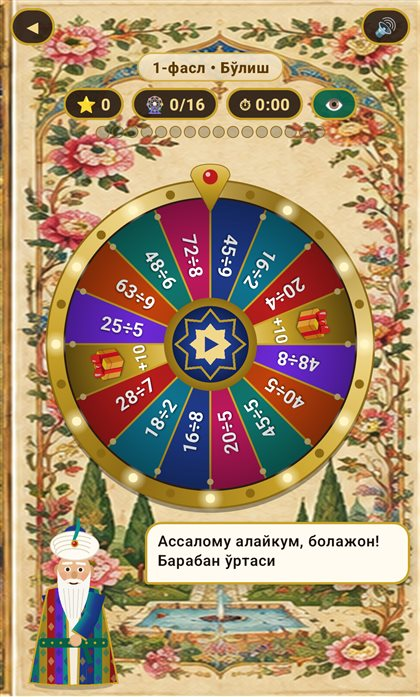
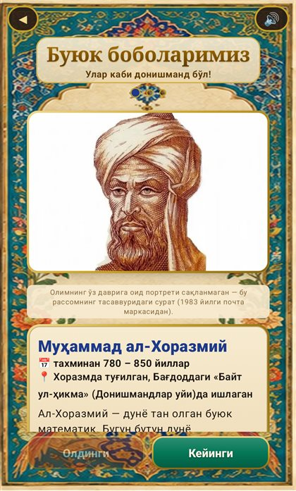
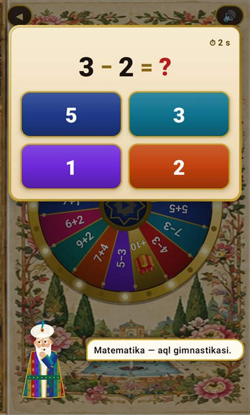
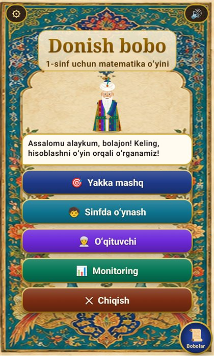

# ➗ Donish bobo

**Arifmetika · Matematika · 1–4-sinf · Android · o‘zbek tilida**

Qo‘shish, ayirish, ko‘paytirish va bo‘lish — sehrli baraban va dono Donish bobo bilan o‘yin kabi qiziqarli.

## Ilova haqida

«Donish bobo» — boshlang‘ich sinf o‘quvchilariga arifmetikani o‘yin orqali o‘rgatuvchi Android ilovasi. Markazda 16 sektorli sharqona baraban turadi: bola uni aylantiradi, tushgan misolni yechadi yoki sovg‘a oladi. Salla va ikat chopon kiygan Donish bobo bolani kuzatadi, to‘g‘ri javobda maqtaydi, xatoda tushuntiradi. Keyingi bosqichga faqat 90% natija bilan o‘tiladi — bu «to‘liq o‘zlashtirish» tamoyili.

## Imkoniyatlar

- 16 sektorli baraban: har bir test — 16 aylanish, mukammal o‘zlashtirish uchun 90% chegara
- Diqqat nazorati: old kamera bola ekranga qarayotganini tekshiradi (tasvir saqlanmaydi)
- Sinf rejimi: o‘qituvchi Wi-Fi nuqta orqali har bir o‘quvchini internetsiz jonli kuzatadi
- Ota-onalar paneli: aniqlik, tezlik, eng zaif amal va 0–100 «o‘rganish reytingi»
- «Buyuk bobolarimiz»: al-Xorazmiy, Beruniy, al-Koshiy haqida bolabop hikoyalar
- O‘zbekcha ovoz, lotin va kirill yozuvlari

## O‘yin ssenariysi

1. 1-fasl — qo‘shish va ayirish, ko‘paytirish, qoldiqsiz bo‘lish
2. 2-fasl — katta sonlar bilan ustun usulida amallar, har bir ustunga maslahat
3. 3-fasl — har xil maxrajli kasrlarni qo‘shish va ayirish

## 🏆 Natija

Prodigy Math, SplashLearn, DragonBox Numbers, Khan Academy Kids va Todo Math bilan 16 mezon bo‘yicha tahlilda **32 balldan 27 ball**.

## O‘rnatish

1. **[donish-bobo.apk](https://github.com/MSoqiy/donish-bobo/raw/main/apk/donish-bobo.apk)** faylini yuklab oling (APK papkasi — [apk/](https://github.com/MSoqiy/donish-bobo/tree/main/apk)).
2. Faylni oching; telefon so‘rasa, «Noma'lum manbalardan o‘rnatish»ga ruxsat bering.
3. «O‘rnatish»ni bosing. Birinchi ishga tushirishda ovoz modellari yuklanadi, keyin ilova internetsiz ishlaydi.

## Ekranlar

## English

**Donish bobo** — Arithmetic learning game for primary school pupils in Uzbek. Free, ad-free, works offline. Part of the *Aqlli o‘yin — bilimli avlod* (Smart games — knowledgeable generation) collection of Uzbek educational apps.

---

**Muallif:** Mamasaidov M.A. — Toshkent shahar Mirzo Ulug‘bek markazi o‘qituvchisi · Tetrasoft · ✉ soqiy65@gmail.com · 🌐 https://msoqiy.github.io

**Boshqa ilovalar:** [Otin buvi](https://github.com/MSoqiy/otin-buvi) · [Bayon AI](https://github.com/MSoqiy/bayon-ai) · [Tilbilgich En AI](https://github.com/MSoqiy/tilbilgich-en) · [Tilbilgich Fr AI](https://github.com/MSoqiy/tilbilgich-fr) · [Tilbilgich De AI](https://github.com/MSoqiy/tilbilgich-de) · [Tilbilgich Ar AI](https://github.com/MSoqiy/tilbilgich-ar) · [Aljabr](https://github.com/MSoqiy/aljabr) · [GeoSayyoh](https://github.com/MSoqiy/geosayyoh)

Kalit so‘zlar: matematika o‘yini, arifmetika bolalar uchun, karra jadvali, qo‘shish va ayirish, boshlang‘ich sinf matematika, mental arifmetika, hisoblashni o‘rganish, математика для детей на узбекском, арифметика начальная школа, o‘zbekcha ta'limiy o‘yin, bolalar uchun ilova, android apk
